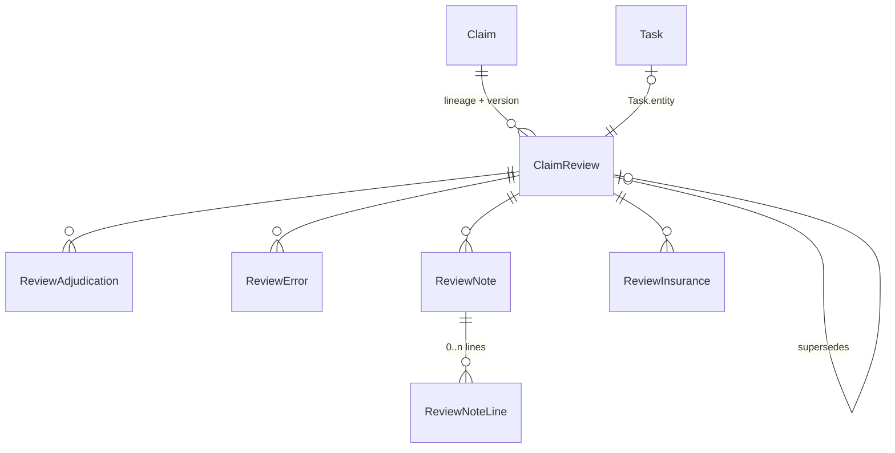

# Feature proposal: auditable claim review (split review)

**Status:** draft for community discussion  
**Modules:** `claim`, `tasks_management`, `api_fhir_r4`, `ClaimModule` (frontend)  
**Audience:** openIMIS developers and implementers  
**Related:** OP-3199 (entities with tasks)  
**Needed by:** [Pre-authorisation and ApprovedBenefit](feature-preauth-approved-benefit.md)  
**See also:** [Price lists as facility agreements](feature-price-list-agreements.md)

## Summary

Today a claim and its review share one set of tables. Each review overwrites the
previous one, so when a claim goes through several reviews (automatic check,
administrative check, medical review, escalation to a specialist) we cannot tell
who decided what, or why.

This RFC moves the review out of the claim:

- A **`ClaimReview`** records one reviewer's decisions on one version of a claim.
  It is modelled on FHIR `ClaimResponse`: adjudications per line, errors,
  process notes, insurance.
- A review stores **only what the reviewer changed**. The reviewer sees the
  state computed from every review so far, and for each line, which review set it.
- Reviews are chained through **tasks**: one task per review, created by
  workflow rules from the previous task's result.
- The automatic check (`claim/validations.py`) becomes the first review.
- The claim response (what the facility sees) is computed from the reviews. It
  is published after each review, at processing and valuation, or only at
  valuation, depending on the scheme's settings. It is final once the claim is
  **valued**. A facility that disagrees goes through the grievance process.

---

## 1. What exists today

| | Where | Problem |
|---|---|---|
| Review fields on the claim and its lines | `Claim`, `ClaimItem`, `ClaimService` (`status`, `rejection_reason`, `price_approved`, `price_adjusted`, `price_valuated`, `qty_approved`, `explanation`, `justification`, `adjustment`, `feedback_status`, `review_status`, `audit_user_id_review`, …) | One value per field: each review overwrites the last, and there is no reviewer per decision. |
| Automatic check | `claim/validations.py`: rejection reasons 1–21, plus processing (deductibles, ceilings, remunerated amounts) | Writes into the same fields as the human reviews. |
| Readers of those fields | `claim`, `claim_sampling`, `claim_batch`, `calcrule_third_party_payment`, `calcrule_capitation_payment`, `api_fhir_r4`, `dhis2_etl`, `policy` | Any change to the fields affects 8 modules. |
| Claim history | `Claim` is a `VersionedModel` (history rows with `legacy_id`) | That is an audit mechanism, not business versions. A claim sent back to the facility cannot keep the reviews of its earlier version. |
| Line identity | `ClaimItem` / `ClaimService` have only a numeric id | Lines are closed and recreated when a claim is amended, so the id is not a stable reference. |

## 2. Goals and non-goals

**Goals**

- A full audit trail: who decided what on which line, at which level, and why.
- Any number of reviews, chained by configurable workflow rules.
- Facilities can see each review as soon as it is submitted, if the scheme
  allows it, and can dispute a decision through the grievance process.
- Claims can be returned to the facility and resubmitted without losing the
  earlier reviews.
- An outward model that maps directly to FHIR `ClaimResponse`.

**Non-goals** (each is a separate RFC; see section 9)

- Merging `ClaimItem` and `ClaimService` into one table.
- Price lists as facility agreements: [separate RFC](feature-price-list-agreements.md).
- Pre-authorisation and `ApprovedBenefit`: [separate RFC](feature-preauth-approved-benefit.md),
  which builds on this one.
- `addItem` (items added by the payer). The model reserves a place for it, but
  it is not implemented.

## 3. Identity: claim versions and line references

A review must stay attached to the version it judged, and a decision to the line
it judged, even after the claim is amended.

- **Claim.** The target model is `OpenIMISBusinessModel`, where business
  versions are separate from the audit trail. The audit is kept by
  django-simple-history in its own table. A review stores:
  - **`claim_lineage`**: the uuid of the claim's first version, copied to every
    later version;
  - **`claim_version`**: the version number it judged.

  It does **not** rely on the claim row's uuid. `OpenIMISModel.uuid` is
  `unique=True` (`core/models/openimis_model.py:217`), so two versions cannot
  share one. `ValidityMixin.replace_object` also looks written for
  `HistoryBusinessModel` (whose primary key is a UUID) and needs fixing before
  the claim can use it (see section 9). Until the claim moves to the new
  model, `claim_version` is kept on the existing claim.
- **Line.** Each `ClaimItem` / `ClaimService` gets a **`line_ref`** (a UUID). It
  is assigned at submission, copied to the line's later versions, and never
  used as a primary key. Decisions reference a line by **content type and
  `line_ref`** (a generic link). That works with two tables today and with one
  table if they are merged later.

## 4. Model

FHIR `ClaimResponse` concepts are given in brackets.



### `ClaimReview` [ClaimResponse, one per reviewer]

| Field | Notes |
|---|---|
| `claim_lineage`, `claim_version` | See section 3. |
| `level` | Integer. The automatic check and the first human review share the lowest level. |
| `kind` | `AUTO`, `ADMIN`, `MEDICAL`, `PREAUTH`, `MIGRATED`, … (a registered list, not an enum in code). |
| `reviewer` | A user, or the system for `AUTO`. |
| `status` | `DRAFT` → `SUBMITTED`. A submitted review cannot be changed. |
| `supersedes` | Points to the earlier revision of the same review (see section 5). |
| `submitted_at` | |

### `ReviewAdjudication` [item.adjudication]

A decision on one line, or on the whole claim if no line is given.

| Field | Notes |
|---|---|
| `line_content_type`, `line_ref` | Empty means the whole claim. |
| `category` | `REJECTED`, `APPROVED_QTY`, `APPROVED_PRICE`, `VALUATED`, …: FHIR adjudication categories, mapped. |
| `reason` | A rejection reason code: the existing 1–21 and new ones. |
| `amount`, `quantity` | Depending on the category. |

### `ReviewError` [error]

A rule the automatic check (or a reviewer) found broken: a code, plus an
optional `line_ref`. This is not a decision: an error explains a rejection that
is recorded as an adjudication.

### `ReviewNote` [processNote]

| Field | Notes |
|---|---|
| `text`, `language` | |
| `visibility` | `display`/`print` (shown to the facility) or `printoper` (internal). Internal notes are never published. |
| lines | Through `ReviewNoteLine`, a note can be linked to 0, 1 or several lines. Not every note concerns a line. |

### `ReviewInsurance` [insurance]

The policy (coverage) applied, with the lines it was applied to (FHIR does not
link insurance to lines; this is an openIMIS extension).

### `addItem`: reserved, not implemented.

## 5. Rules

1. **A review stores only changes.** A line the reviewer left alone has no
   adjudication. Reversing an earlier rejection is itself a change, and is
   stored as one.
2. **Computed state.** For the current claim version, using the latest
   revision of each submitted review:
   - per line, the **highest level wins**;
   - **within a level, decisions add up**: any rejection rejects, and the
     lowest approved quantity and amount apply.
3. **Each line records where its result came from.** The computed state gives,
   for each line, the review that set it (reviewer, level, date). The UI shows
   this as a tooltip on the line, which expands to that line's history at that
   level, and as an "other reviews" tab listing the claim's other reviews.
4. **Reversals from a lower level.** A lower-level review cannot reverse a
   higher level's decision. The attempt is ignored and the reviewer gets a
   warning. A disagreement within one level is settled by people: one reviewer
   asks the other to change their review.
5. **Changing a submitted review** creates a new revision: same reviewer and
   level, `supersedes` the earlier one. Only the latest revision counts; earlier
   ones stay visible in the history.
6. **Earlier claim versions.** Their reviews are **shown but not applied**. The
   reviewer of version 2 sees why version 1 was sent back.
7. **Finality.** The claim is final when it is **valued**. Unless valuation runs
   in a batch with closing of accounts, valuation happens during processing.
8. **Claim response.** Computed from the reviews (rule 2), filtered by note
   visibility. A scheme setting decides when it is published:

   | Setting | Published |
   |---|---|
   | `ALL_REVIEWS` | after each submitted review (outcome `partial`), then at processing and valuation |
   | `PROCESSED_AND_VALUATED` | at processing (`partial` if valuation is still to come), then at valuation |
   | `VALUATED` | only at valuation (`complete`) |

   Each publication can trigger a subscription. The response is frozen when the
   claim is valued.
9. **Disputes go through grievance.** A facility that disagrees with a
   published decision opens a grievance, which references the published claim
   response. A dispute does not pause or change the chain of reviews.

## 6. Tasks and workflow

- **One task per review.** `Task.entity` is the `ClaimReview`. Opening the task
  opens the review page, which loads the claim and allows adjudications. In the
  first release this is the current review page, rewired to the review's uuid,
  with its own query and mutation.
- **Task steps are votes within one level.** Each person acting on the task
  gets their own review on it, and their decisions are combined under rule 2.
- **Task results:**

  | Result | Effect |
  |---|---|
  | approve | Approves at this level only. Adds no adjudication. |
  | reject | Rejects the whole claim. A note is required, and it is attached to the review with a claim-level `REJECTED` adjudication. |
  | escalate | A message is required; naming lines is optional. Something can be odd as a whole even when no single line is wrong. |

  Submitting the review can also complete the task.
- **Workflow rules** decide what comes next: another level, a specialist,
  return to the facility, or done. Escalation is an input to these rules, not
  special code.
- **Return to the facility** uses a new claim status, **`CHALLENGED`** (proposed
  value 32, following the existing 1, 2, 4, 8, 16). The facility resubmits as a
  new claim version (rule 6).

## 7. Migration and rollout

| Step | What | Rollback |
|---|---|---|
| **A. Rewire** | New tables; the review page and the automatic check write reviews. The old fields stay up to date, computed from the reviews, so the 8 readers are unaffected. | Stop writing reviews; old fields are intact. |
| **B. Country migration** | A management command builds reviews from historic claims: an `AUTO` review from `rejection_reason`, and a `MIGRATED` review from the old review fields (`audit_user_id_review`). It produces a comparison report. Each country runs it, checks the report, then confirms. | The command can be run again; it never changes the claim tables. |
| **C. Switch readers, then drop fields** | Each of the 8 modules reads the computed state or the claim response. Old fields are dropped only once all have switched. | Per module, until the drop. |

## 8. FHIR mapping

| openIMIS | FHIR `ClaimResponse` | Notes |
|---|---|---|
| computed state | `ClaimResponse` | `outcome = partial` until valuation, then `complete`. When it is published depends on the scheme's setting (rule 8). |
| `ReviewAdjudication` | `item.adjudication` / `adjudication` | The line is given by `itemSequence`, built from `line_ref`. |
| `ReviewError` | `error` | |
| `ReviewNote` | `processNote` | `type` = visibility. Internal notes are not published. |
| `ReviewInsurance` | `insurance` | **Extension:** the lines the policy was applied to. |

`api_fhir_r4/converters/claimResponseConverter.py` already maps the claim to a
`ClaimResponse`. It will read the computed state instead.

## 9. Related work

- **Merge `ClaimItem` / `ClaimService`** behind a generic link: future RFC.
  `line_ref` and the generic link in this RFC prepare for it.
- **[Price lists as facility agreements](feature-price-list-agreements.md)**:
  separate RFC.
- **[Pre-authorisation and ApprovedBenefit](feature-preauth-approved-benefit.md)**:
  separate RFC, which needs this one.
- **`ValidityMixin.replace_object` on `OpenIMISBusinessModel`**: OP-3230
  (tech debt, OP-3181). Reproduced on `UserBusinessAccess`: the copy keeps the unique
  uuid, so the insert fails; past that, the integer `id` is written into the
  UUID field `replacement_uuid`.
- **Grievance**: the route for facility disputes (rule 9). It references the
  published claim response.

## 10. Open questions

None at the moment. Decisions taken during review of this draft:

- Facility disputes go through grievance and do not pause the reviews (rule 9).
- The return-to-facility status is `CHALLENGED` (section 6).
- Publication has three settings (rule 8).

## 11. Definition of done

```gherkin
Feature: Auditable claim review

  Background:
    Given a claim with lines "A" and "B" submitted by a facility
    And the automatic check has reviewed it at level 1

  Scenario: The automatic check is recorded as a review
    When the automatic check rejects line "A" for reason 3
    Then the claim has an AUTO review at level 1
    And that review has a REJECTED adjudication on line "A" with reason 3
    And line "B" has no adjudication in that review

  Scenario: A review stores only what the reviewer changed
    Given a medical reviewer opens a level 2 review
    When they reduce the approved quantity of line "B" and submit
    Then their review has one adjudication, on line "B"
    And the computed state shows line "A" rejected by the AUTO review
    And the computed state shows line "B" reduced by the medical reviewer

  Scenario: A higher level reverses a rejection
    Given the automatic check rejected line "A"
    When a level 2 reviewer approves line "A" and submits
    Then the computed state shows line "A" approved, set by the level 2 review
    And the AUTO review still records the rejection

  Scenario: Decisions add up within a level
    Given two level 2 reviewers act on the same task
    When one rejects line "B" and the other leaves it untouched
    Then the computed state shows line "B" rejected

  Scenario: A lower level cannot reverse a higher level
    Given a level 2 review rejected line "B"
    When a level 1 reviewer approves line "B"
    Then the reviewer is warned
    And the computed state still shows line "B" rejected

  Scenario: Changing a submitted review creates a revision
    Given a submitted level 2 review
    When its reviewer changes a decision
    Then a new review superseding the first is created
    And the first review is unchanged and visible in the history
    And only the new revision is used in the computed state

  Scenario: Rejecting the task rejects the claim
    When a reviewer rejects the task without a note
    Then the task is not completed
    When they reject it with a note
    Then the review has a claim-level REJECTED adjudication with that note

  Scenario: Returned claim keeps earlier reviews visible
    Given version 1 of the claim was returned to the facility
    And its status is CHALLENGED
    When the facility resubmits it as version 2
    Then line references are unchanged on lines the facility kept
    And the reviews of version 1 are shown on the review page
    And the computed state for version 2 ignores them

  Scenario: Internal notes are never published
    Given the scheme's publication setting is ALL_REVIEWS
    When a reviewer adds an internal note and a facility-visible note
    Then the published claim response contains only the facility-visible note

  Scenario: Nothing is published before valuation when the setting is VALUATED
    Given the scheme's publication setting is VALUATED
    When a level 2 review is submitted and the claim is processed
    Then no claim response is published
    When the claim is valued
    Then a complete claim response is published

  Scenario: Migration does not change claims
    When a country runs the review migration
    Then every historic claim has the reviews rebuilt from its fields
    And the comparison report shows no difference with the old fields
    And no claim, item or service row was changed
```
